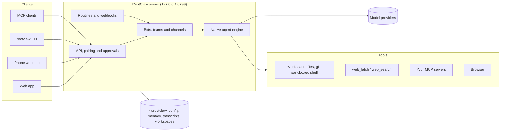

<div align="center">


# RootClaw

**A self-hosted workspace for a team of AI bots, on any model provider you choose.**

Give each bot a model, a job and its own workspace. Put them in teams, schedule their work,
and stay in control with approvals. Everything runs on your machine or your server,
and your data stays in `~/.rootclaw`.

[](https://github.com/cryptyroot-ux/RootClaw/actions/workflows/ci.yml)
[](LICENSE)
[](docs/install.md#requirements)

[Quick start](#quick-start) · [Features](#features) · [Architecture](#architecture) · [Docs](#documentation) · [Contributing](#contributing)

</div>

---

## Why RootClaw

- **No vendor lock-in.** Bots run on RootClaw's own native agent engine, which talks to provider APIs
  directly. Switch a bot from Anthropic to OpenRouter to a self-hosted OpenAI-compatible endpoint
  without changing anything else. No external agent CLI is installed or spawned.
- **You decide what a bot may do.** Every bot has an approval level. Shell commands, file writes,
  web access and actions in connected apps can wait for your yes, or run on their own once you trust the bot.
- **Built to run unattended.** One server keeps your bots, teams, routines and webhooks going while your
  laptop is closed, and you reach it from a browser, your phone, the CLI or another agent over MCP.

## Features

### Native agent engine

- One in-process tool loop for every provider, with streaming, tool calling and retries.
- Context compaction: long conversations are summarized while recent exchanges stay verbatim.
- Backup models: if a turn fails before anything reached you, it moves to the next model in the bot's fallback chain.
- Budget guard: per-turn, daily and monthly token and USD caps, globally or per bot.
- Loop guard: repeated identical tool calls are answered from the earlier result or stopped.
- Text-only models get a clear note in place of images they cannot read.

### Tools for real work

- Per-bot workspace with file read, write and patch, and git status, diff, log and commit (never push).
- Shell commands inside a [bubblewrap](https://github.com/containers/bubblewrap) sandbox on Linux.
- `web_fetch` and `web_search`, with no extra API key.
- Your own [MCP servers](docs/custom-mcp-servers.md), plus a browser for bots (`rootclaw browser install`).
- [Tool selection](docs/tool-selection.md) to send a small model only the tools it needs.

### Teams and automation

- Bots with their own instructions, skills and [memory](docs/memory.md) (plain markdown files you can edit).
- Teams and channels where bots hand work to each other; share a whole department as one file.
- [Routines](docs/routine-schedules.md) on a schedule and webhooks that start work from outside.
- [Approval levels](docs/approval-levels.md): **Ask for approval**, **Approve for me** or **Full access**, per bot.

### Run it anywhere

- [Headless CLI](docs/headless-cli.md) for scripts and CI: `rootclaw run BOT "do this"` waits until the job and every teammate it asked are done, with JSON output and meaningful exit codes.
- [MCP server](docs/mcp-server.md) so another agent or MCP client can coordinate your RootClaw team.
- [Self-hosting](docs/self-hosting.md) on a VPS as a systemd service, reachable over Tailscale or your own domain with HTTPS.
- Pair a browser or phone with a code; add the web app to your phone's home screen.

## Supported providers

| Provider | Instance id |
| --- | --- |
| Anthropic | `anthropicApi` |
| OpenAI (Chat Completions and Responses API) | `openai`, `openaiResponses` |
| Google Gemini | `geminiApi` |
| OpenRouter | `openrouter` |
| Ollama Cloud | `ollamaCloud` |
| xAI | `xaiApi` |
| Groq | `groq` |
| Mistral | `mistral` |
| Cerebras | `cerebras` |
| Meta | `meta` |
| Any OpenAI-compatible endpoint (a local model server, a gateway, …) | `openaiCompat`, or as many custom instances as you like |

Keys are saved in `~/.rootclaw/config.json` (mode 600) and never sent back through the API.
Details per provider: [docs/api-providers.md](docs/api-providers.md).

## Quick start

Requirements: Linux or macOS, **Node.js 24+**, git, and `bubblewrap` on Linux for the bots' shell tool.
The web build needs about 6 GB of memory. The full guide is [docs/install.md](docs/install.md).

```bash
git clone https://github.com/cryptyroot-ux/RootClaw.git && cd RootClaw
corepack enable                 # provides pnpm 10.33.0 (as non-root: corepack enable --install-directory ~/.local/bin)
pnpm install --frozen-lockfile
NODE_OPTIONS=--max-old-space-size=6144 pnpm build
pnpm build:server
pnpm start                      # RootClaw is running on http://127.0.0.1:8799
```

In a second terminal, add a provider key and talk to your first bot:

```bash
alias rootclaw="node $PWD/dist-server/rootclaw.js"
export ROOTCLAW_OLLAMA_API_KEY=...                        # or Anthropic, OpenAI, OpenRouter, …
rootclaw engine set ollama --key-env ROOTCLAW_OLLAMA_API_KEY
rootclaw models                                           # every model you can use now
rootclaw new-bot helper --model ollamaCloud/gemma4:31b
rootclaw run helper "Create hello.txt in your workspace containing: it works"
```

Then open <http://127.0.0.1:8799> in a browser on the same machine. You can also add keys there,
under **Settings → API keys**.

> RootClaw is installed from source; there is no npm package yet. Keep port `8799` on localhost or
> behind an authenticated HTTPS path, and run the server as an unprivileged user.
> For a server that stays up, see [Deploy on a VPS](docs/deploy-vps.md).

## Architecture



- **One server** (`server/`) is plain Node with no web framework. It serves the API and the web app (`src/`)
  and keeps all state in the data directory. The `rootclaw` CLI and the stdio MCP server (`rootclaw mcp`) talk to it.
- **The native engine** (`server/drivers/`) runs each turn: it builds the context, calls the provider through
  a model adapter, runs tools through the approval gate, and handles retries, fallback and budgets.
- **Every tool call passes the gate.** What needs a person depends on the bot's approval level
  ([docs/approval-levels.md](docs/approval-levels.md)).

## Documentation

| Topic | Guide |
| --- | --- |
| Install on Linux or macOS | [docs/install.md](docs/install.md) |
| Deploy on a VPS | [docs/deploy-vps.md](docs/deploy-vps.md) |
| Self-hosting and security model | [docs/self-hosting.md](docs/self-hosting.md) |
| Providers and keys | [docs/api-providers.md](docs/api-providers.md) |
| Fallback chain and budgets | [docs/fallback-and-budgets.md](docs/fallback-and-budgets.md) |
| Approval levels | [docs/approval-levels.md](docs/approval-levels.md) |
| Headless CLI | [docs/headless-cli.md](docs/headless-cli.md) |
| MCP server | [docs/mcp-server.md](docs/mcp-server.md) |
| Your own MCP servers | [docs/custom-mcp-servers.md](docs/custom-mcp-servers.md) |
| Bot memory | [docs/memory.md](docs/memory.md) |
| Migrating from external engines | [docs/migration.md](docs/migration.md) |

## Development

```bash
pnpm dev:server    # API server from source on 127.0.0.1:8799
pnpm dev           # web app (Vite) on http://127.0.0.1:5199
pnpm typecheck && pnpm lint && pnpm test
```

## Contributing

Issues and pull requests are welcome. Please read [CONTRIBUTING.md](CONTRIBUTING.md) first; it covers the
dev setup, tests and what makes a PR easy to merge. Report security problems privately as described in
[SECURITY.md](SECURITY.md), not in a public issue. This project follows the
[Code of Conduct](CODE_OF_CONDUCT.md).

## License

RootClaw is released under the [Apache License 2.0](LICENSE). It is derived from
[OpenMausBot](https://github.com/milind-soni/OpenMausBot); see [NOTICE](NOTICE) for attributions.
